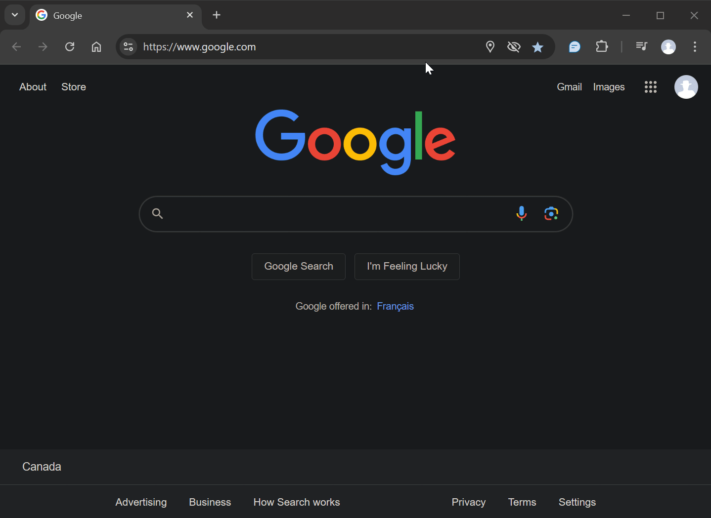

# AI Roundtable

This Chrome extension allows you to input your question once and have an answer from multiple AI assistants at once. You can customize which assistants you wish to ask your question.

## Demo

## Keyboard Shortcuts

<table>
    <tr>
        <th>Action</th>
        <th>Shortcut (PC/Mac)</th>
    </tr>
    <tr>
        <td>Open the pop up to begin typing a new Query</td>
        <td>Ctrl/Option + Shift + Q</td>
    </tr>
    <tr>
        <td>Toggle Gemini</td>
        <td>Alt/Option + 1</td>
    </tr>
    <tr>
        <td>Toggle Claude</td>
        <td>Alt/Option + 2</td>
    </tr>
    <tr>
        <td>Toggle Copilot</td>
        <td>Alt/Option + 3</td>
    </tr>
    <tr>
        <td>Toggle Perplexity</td>
        <td>Alt/Option + 4</td>
    </tr>
    <tr>
        <td>Toggle ChatGPT</td>
        <td>Alt/Option + 5</td>
    </tr>
    <tr>
        <td>Toggle Meta AI</td>
        <td>Alt/Option + 6</td>
    </tr>
    <tr>
        <td>Submit Query</td>
        <td>Ctrl + Enter</td>
    </tr>
</table>

